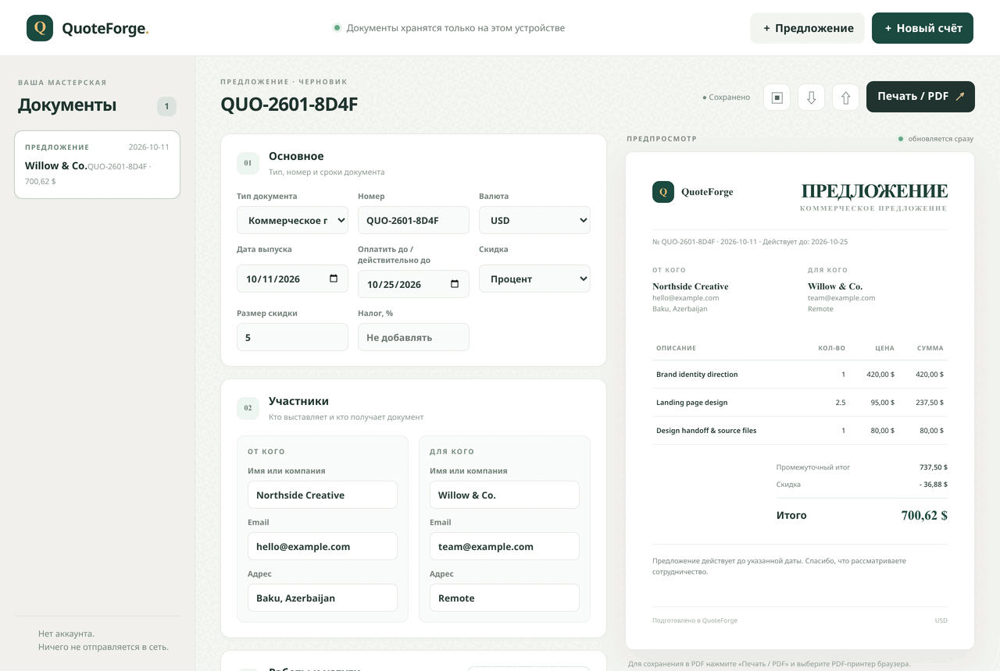

# QuoteForge

QuoteForge is a local-first invoice and quote builder for independent freelancers. Create a document, add work items, apply a fixed or percentage discount, optionally add tax, and see a print-ready preview update as you edit.



## Run locally

Requires Node.js 20 or later. From this folder run:

```sh
npm start
```

Then open `http://127.0.0.1:4173`. The app also works as a static site on GitHub Pages.

## Included

- Invoices and commercial proposals with dates, document numbers, sender and client details, notes, and multiple currencies.
- Line items with fractional quantities, fixed or percentage discounts, and an optional tax rate.
- Live totals and a paper-style print view. Use the browser's print dialog to save as PDF; the app does not generate or upload PDFs itself.
- Multiple local drafts, duplicate, JSON import/export, and browser print.
- Integer-cent arithmetic with decimal parsing and explicit half-away-from-zero rounding; totals beyond safe cent precision remain decimal strings through currency formatting to avoid silently losing precision.
- Local storage only. No accounts, server-side document handling, analytics, external fonts, payment processing, or network calls from the app.

## Data and limitations

Drafts are stored in this browser's local storage. Clearing site data removes them, so export JSON backups for documents you need to keep. Imported JSON is checked against schema version 1. A different device or browser does not automatically receive your drafts.

Tax and discount amounts are arithmetic helpers, not country-specific tax advice. Check the applicable rules and document requirements yourself. Currency conversion, email delivery, electronic signatures, payment collection, recurring invoices, and direct PDF generation are not included. Line-item quantity is rounded to six decimal places; prices and calculated line totals use two decimal places. Tax is calculated on the discounted subtotal.

## Development

```sh
npm test
npm run check
```

MIT licensed. See [LICENSE](LICENSE).
